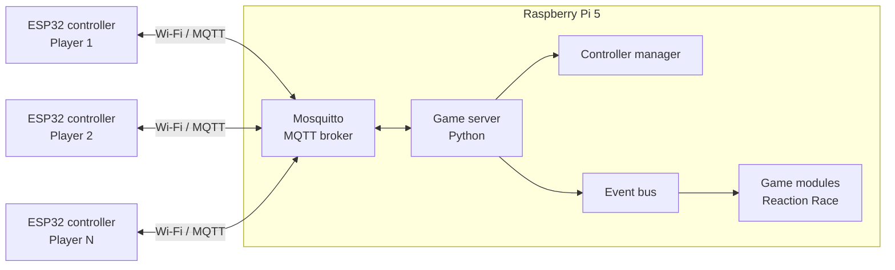

# Nexus Connect

**A wireless physical game system. ESP32 controllers talk to a Raspberry Pi 5 game server over Wi-Fi and MQTT, so a game can add players just by powering on another controller.**

Nexus Connect is my own project, from idea to implementation. Each controller is an ESP32 with a button and an LED. The Raspberry Pi registers controllers automatically, assigns player numbers, tracks which controllers are online, and runs the game logic.

<!-- Demo video or GIF goes here. Drag the file into the GitHub editor to upload it, then delete this comment. -->

## First game: Reaction Race

1. When two or more controllers are online, every controller's LED blinks three times to start the round.
2. After a random wait of 0 to 10 seconds, all the LEDs turn on at the same moment.
3. The first player to press their button wins, and the controller reports their reaction time in milliseconds.
4. Pressing before the LEDs turn on is a false start.
5. A new round starts automatically after 5 seconds.

## Architecture



- **Controllers** publish registrations, heartbeats and button events, and subscribe to player assignments and LED commands.
- **The game server** turns MQTT messages into game events. The **controller manager** assigns player numbers and marks a controller offline if its heartbeats stop for 15 seconds.
- **The event bus** keeps game logic separate from networking, so a new game is a new module, not a rewrite.

## Engineering challenges

### Making LEDs on separate wireless boards turn on at the same time

Sending a "turn on now" message doesn't work. Each controller receives it after a different Wi-Fi delay, so the LEDs light up at visibly different times and the game becomes unfair. To fix it:

- Each ESP32 syncs its clock over NTP. The Pi sends a **scheduled start time** (`start_epoch_ms`) instead of a "now" command, and every controller turns its LED on when its own clock reaches that time. Network delay no longer affects when the LEDs light up.
- If a controller's clock hasn't synced yet, it falls back to a relative delay (`fallback_delay_ms`) measured from when the message arrived.
- If one controller is still consistently early or late, it can be tuned with a **per-controller timing offset** in `controller_config.py`.
- "LEDs off" commands are repeated for a short window, so a single dropped message can't leave an LED stuck on.

### Fair reaction times

If the Pi timed each press, Wi-Fi delay would be added to every player's score. Instead, **each controller measures its own reaction time** from the moment its LED turns on and includes it in the button event (`reaction_ms`). The Pi uses that number to decide the winner.

### Plug-and-play controllers

Each controller uses its **MAC address** as a permanent ID, so the same sketch runs on every board with no per-board edits. New controllers get the next free player number automatically, and specific boards can be pinned to specific player numbers in `controller_config.py`.

## Tech stack

| Layer | Technology |
|-------|------------|
| Controllers | ESP32-C3, Arduino C++, PubSubClient |
| Messaging | MQTT (Mosquitto) |
| Game server | Raspberry Pi 5, Python 3, paho-mqtt |
| Testing | pytest |

## Repository layout

```text
raspberry-pi/
  game_server.py          Game server: MQTT handling, registration, heartbeats, events
  controller_manager.py   Player numbers, online status, last-seen timestamps
  controller_config.py    Fixed player assignments and per-controller LED timing offsets
  event_bus.py            In-process event bus that routes controller input to games
  games/reaction_race.py  Reaction Race game logic
  tests/                  Unit tests for Reaction Race

esp32_controller/
  esp32_controller.ino    Controller firmware: registration, heartbeats, button events, LED commands
  wifi_secrets.example.h  Template for Wi-Fi credentials and the broker address

docs/                     Protocol and design notes
legacy/                   Earlier prototypes, kept for reference
```

## MQTT topics

| Topic | Direction | Purpose |
|-------|-----------|---------|
| `controller/register` | Controller → Pi | Announce a controller by MAC address |
| `controller/assign` | Pi → Controller | Assign a player number |
| `controller/heartbeat` | Controller → Pi | "Still online" message every 5 seconds |
| `controller/event` | Controller → Pi | Button presses, with reaction time |
| `controller/command` | Pi → Controller | Scheduled LED commands |
| `game/state` | Pi → all | Current game status, winner and reaction time |

Example button event:

```json
{"type":"event","controller_id":"94:A9:90:68:A1:90","event":"button.press","control":"main_button","value":1,"reaction_ms":212}
```

See [docs/controller-registration-v1.md](docs/controller-registration-v1.md) and [docs/event-system.md](docs/event-system.md) for the full message formats.

## Getting started

### Raspberry Pi

```bash
sudo apt update
sudo apt install mosquitto mosquitto-clients python3-pip
python3 -m pip install paho-mqtt
```

Mosquitto 2.x only accepts local connections by default. To let the ESP32s connect, add these lines to `/etc/mosquitto/conf.d/nexus.conf`, then run `sudo systemctl restart mosquitto`:

```text
listener 1883
allow_anonymous true
```

Start the game server:

```bash
cd raspberry-pi
python3 game_server.py
```

### ESP32 controllers

1. Copy `esp32_controller/wifi_secrets.example.h` to `esp32_controller/wifi_secrets.h`.
2. Fill in your Wi-Fi name, Wi-Fi password and the Raspberry Pi's IP address. `wifi_secrets.h` is ignored by Git.
3. Open `esp32_controller/esp32_controller.ino` in the Arduino IDE and upload it to each controller.
4. Wire a button to D9 and an LED to D10.

Each controller registers itself when it connects. The Pi prints its MAC address and assigned player number.

### Run the tests

```bash
cd raspberry-pi
python3 -m pytest tests
```

## Author

Created by Anthony Walston.
